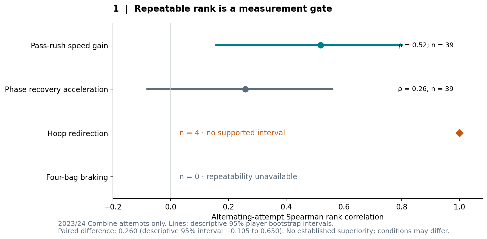
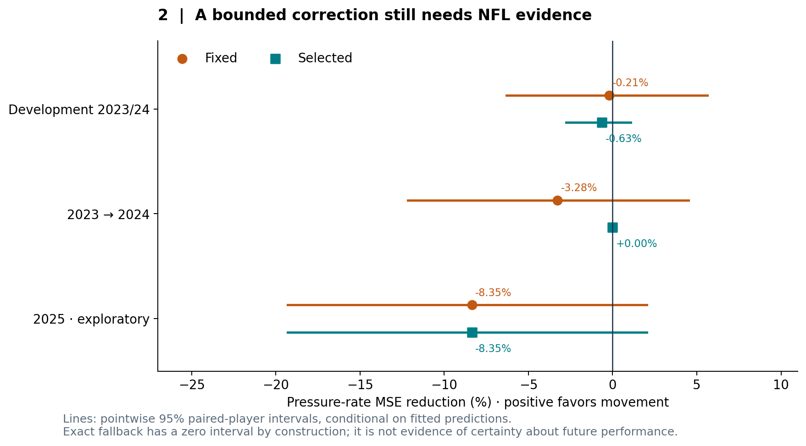
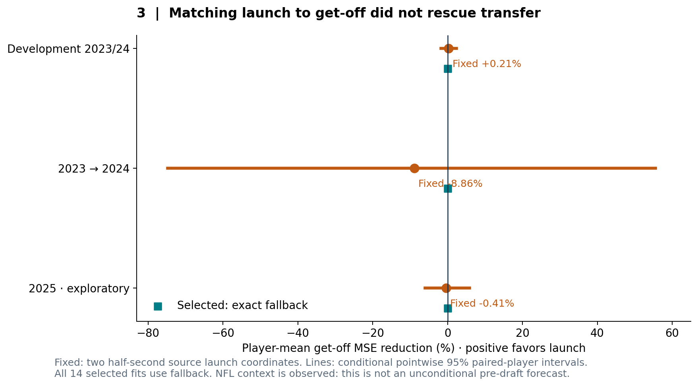
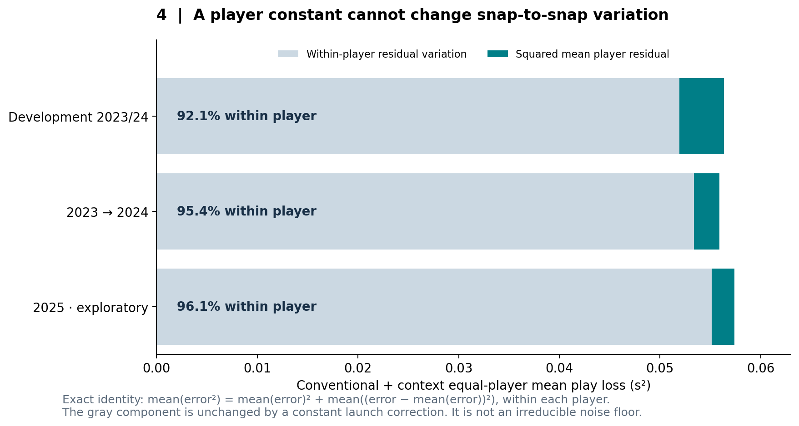

# Before ranking the rush: test the measurement, then test its NFL value

*Defensive-line analysis for NFL Big Data Bowl 2027 · proposed entry for review*

A scout watching a defensive lineman's Combine drill wants to know whether the movement will survive an NFL blocker. Tracking offers detail that a stopwatch misses, but that detail must pass two tests: does it recur across attempts, and does it improve forecasts beyond the measurements teams already have?

Our 74-player study separates those tests. Pass-rush speed gain shows moderate repeat-attempt rank stability. Neither a compact movement correction nor a more targeted launch correction establishes incremental NFL forecasting value. The actionable result is a disciplined use of tracking: prioritize supported measurements for drill review, retain the conventional forecast, and require evidence of transfer before changing a prospect's grade.

## Start with the football question and the denominator

We link 10 Hz Combine tracking to 14,665 eligible rookie regular-season records for 74 defensive linemen: 23 from 2023, 22 from 2024 and 29 from 2025. The source feature collection contains 361 accepted attempts. NFL eligibility requires the historical position filter, non-nullified plays, finite charted get-off, a unique snap record, a source profile and at least 30 retained records per player.

Pressure means a nonmissing supplied `time_to_pressure`, averaged within player over this retained sample. It is an observed pressure-event fraction, not an unconditional pressure probability across every NFL pass-rush opportunity. Selection into playing time and charting matters. These data cannot establish an all-prospect career ranking or a causal athletic effect.

Development uses the 45 players from 2023/24. The 29-player 2025 class was previously examined and remains exploratory. Entire athletes stay together during tuning, testing and resampling. Repeated fold appearances do not create extra players.

## Gate one: can we measure the movement consistently?

Four declared coordinates describe pass-rush speed gain, operational phase recovery acceleration, hoop redirection and four-bag braking. The movement engine summarizes multiple possible phase segmentations. Its phases are mathematical templates, not annotated physiological states.

The compact speed-gain coordinate is net smoothed speed change over the extracted active window, up to approximately six seconds, averaged across accepted onset scenarios and then summarized by player medians. It is **not** a half-second first-step or reaction-time measure. Recovery acceleration summarizes acceleration in the engine's final phase.

For development players, we alternate attempts ordered by event ID, take each half's median and correlate ranks across players. Speed gain has Spearman correlation 0.519 across 39 repeated players; recovery acceleration has 0.259 across 39. Their descriptive 95% player-bootstrap intervals are 0.158–0.801 and −0.080–0.559. This is rank stability across potentially different instructions, not absolute agreement under standardized repetitions. A new source-only paired bootstrap of the same 39 players estimates their correlation difference as 0.260, with descriptive 95% interval −0.105–0.650 over 4,000 joint resamples. It does not establish superiority of speed gain; its higher point estimate is a measurement priority to investigate, not a settled ranking. This diagnostic was chosen after seeing the marginal results and is exploratory.

For a coach, the immediate implication is measurement planning: collect comparable repetitions before interpreting changes in a player's profile. Hoop's correlation of 1.00 on four players cannot justify a reliability claim. Four-bag braking has no repeatability estimate here. Those gaps are reasons to improve observation, not to discard athletes.

## Gate two: does tracking earn a change to the forecast?

Our conventional baseline tunes ridge regression over three fixed subsets of 15 body, timed-test and NGS fields, including a mean fallback. This is stronger than stopwatch timing alone. All candidates share source Combine position and drill-availability indicators. Every source position is simply DL; the source-position mean therefore duplicates the global mean and is not a differentiated edge/interior benchmark.

The compact model adds four movement coordinates to a separately tuned conventional forecast. Training-only preprocessing and cross-fitted residual responses keep held-player NFL labels outside prediction fitting. The fixed correction is halved and capped at two absolute percentage points; inner validation chooses between that correction and exact fallback. Its one-standard-error acceptance rule is a heuristic, not a guarantee of future improvement.

Positive gain means lower equal-player squared error. Selected compact MSE is 0.000959202 versus conventional 0.000953206 in development: **0.63% worse**. The 2023→2024 run returns exact fallback at MSE 0.001525834. Exploratory 2025 worsens **8.35%**, from 0.000714146 to 0.000773802. The forced correction also fails to improve any of these three aggregate comparisons.

The conventional baseline itself beats the global mean in development: MSE 0.000953206 versus 0.001135307, a **16.0% reduction relative to the mean baseline**. That is a useful comparator, not a new independent validation. Adding tracking has to clear this stronger hurdle.

An earlier broader residual strategy also worsened development error by 2.878%. Favorable earlier specifications remain exploratory results on reused players. They do not overturn the compact failure. Twenty complete training-player refits per temporal comparison provide coarse sensitivity diagnostics. Sixteen feature-mislinking runs always select fallback; that control does not demonstrate useful movement learning or supply a formal significance test.

## A closer football mechanism still needs the same evidence

Pressure mixes launch, block engagement, alignment, assignment, opponent and opportunity. We therefore also test two fixed pass-rush-drill launch measurements against charted NFL `player_get_off`: speed gain and displacement over exactly 0.5 seconds after operational movement onset. Onset requires three consecutive recorded speeds above one yard/second, and timestamps are interpolated to the exact endpoint. It does not measure reaction to an official cue. There are 143 accepted launch attempts covering all 74 players; these are a separate extraction, not 143 additional athletes.

The NFL comparison conditions on recorded down/distance, score, quarter, formation, lineup and snap geometry. Context and source nuisance fits exclude each held player's responses, including indirect paths through peer residuals. Observed NFL context makes this a conditional prediction task, not an unconditional pre-draft forecast. It does not isolate causal athletic ability or fully adjust for opponent quality and assignment.

The primary loss squares each player's mean forecast error, then weights players equally. Fixed launch changes that loss by **+0.21%** in development, **−8.86%** for 2023→2024 and **−0.41%** in exploratory 2025. Every conditional 95% absolute-gain interval spans gains and losses. All 14 selected fits retain exact fallback.

## An additional insight: player calibration and snap timing are different jobs

The existing losses reveal a structural limit. For residual error e within one player,

`mean(e²) = mean(e)² + mean((e − mean(e))²)`.

The first term is systematic player-mean error; the second is residual variation across that player's snaps. A player-level launch correction adds the same constant to every snap. It can change the first term, but leaves the second exactly unchanged.

In the conventional-plus-context model, within-player residual variation accounts for **92.1%, 95.4% and 96.1%** of equal-player play-level MSE in development, 2024 and exploratory 2025. These percentages follow directly from existing aggregate losses. Therefore even a label-aware oracle choosing perfect player constants could reduce play-level loss by at most 7.86%, 4.56% and 3.94%, respectively, with this context baseline fixed. Those ceilings are not achieved gains, a new fitted experiment, or irreducible noise estimates.

This explains why the same absolute deterioration in 2024 is 8.86% on player-mean loss but only 0.404% on play-level loss: the denominators answer different football questions. A scout evaluating average timing and a coach preparing for individual snaps need different evidence. A context-dependent movement interaction would be a new hypothesis requiring a new test; these results do not validate it.

## What a team can use now

Use the profiles to structure film and drill review, with repeat counts visible. Prioritize standardized repeat measurements of speed gain while treating phase recovery as provisional. Retain conventional predictions for prospect evaluation. Do not turn a moderately repeatable drill quantity into a hidden-talent ranking, a training prescription, or a claim of better individual-snap timing.

The uncertainty is substantial: 4,000 paired-player resamples condition on fixed predictions; get-off intervals omit model refitting, shared games/teams, prior researcher adaptation and future class shift. Twenty pressure refits do not resolve those limitations. Null findings do not prove that tracking is useless or exclude small effects.

The linked notebook preserves the original extraction and estimators. Its receipt mode reproduces these four aggregate figures without restricted rows; its raw mode requires the nine hash-pinned official files. Historical receipts document a complete official rebuild with 12 pressure and 30 get-off MSE comparisons matching prior runs. This revision exactly replays the saved-attempt repeatability audit, adds the exploratory paired comparison and derives the loss identity. It does not claim a fresh raw-tracking reconstruction or NFL model refit. No restricted rows, player forecasts or separate linebacker results are included.

Code and experimental specifications: [PerfectPower](https://github.com/towre676-cloud/perfectpower/tree/main/research/kaggle_combine). The accompanying `Combine_Submission_2027.ipynb` is prepared for the required public Kaggle attachment, which remains a publication step pending author approval.
